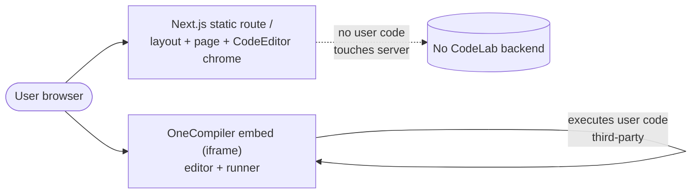
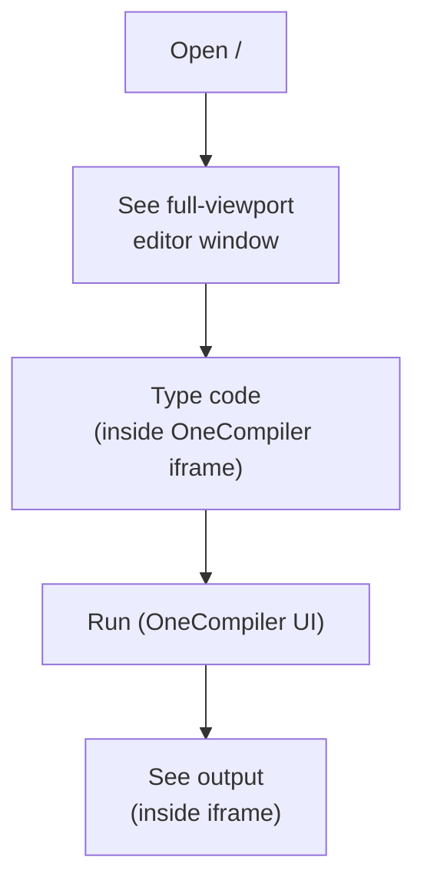
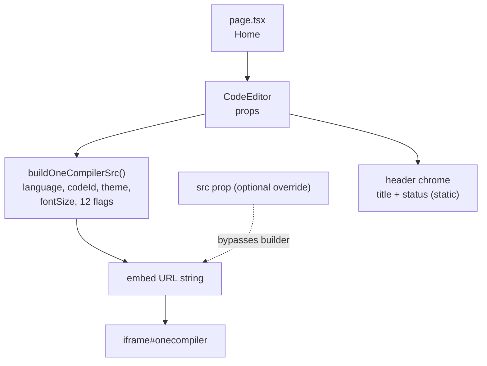
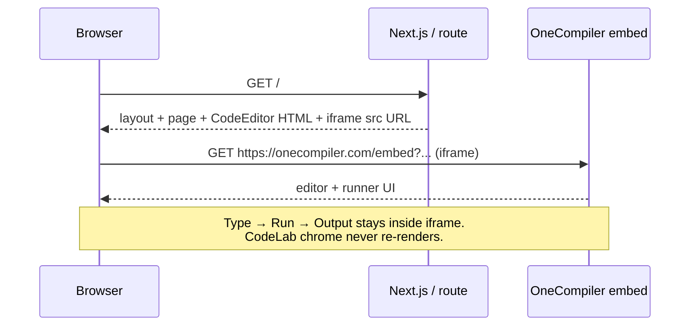

<h1 align="center">
  
  <br />
  CodeLab — Online Compiler
</h1>

<p align="center">
  Write, compile and run code online. A zero-backend online coding environment<br />
  <br /><br />
</p>

<p align="center">
  
  <br />
  <em>CodeLab brand mark — <code>public/favicon.png</code> / <code>favicon.ico</code></em>
</p>

<p align="center">
  
  
  
  
  
  
  
</p>

---

<h2 align="center">Table of Contents</h2>

- [What is CodeLab?](#what-is-codelab)
- [Live Preview / Screens](#live-preview--screens)
- [How It Works — Diagrams & Flows](#how-it-works--diagrams--flows)
- [Repository Structure](#repository-structure)
- [Tech Stack](#tech-stack)
- [Features (FR-01–FR-10)](#features-fr-01fr-10)
- [Getting Started](#getting-started)
- [Usage & Code Snippets](#usage--code-snippets)
- [Embed URL Contract (OneCompiler)](#embed-url-contract-onecompiler)
- [Design System](#design-system)
- [Configuration](#configuration)
- [Deployment](#deployment)
- [Testing, Security, Performance](#testing-security-performance)
- [Known Issues](#known-issues)
- [Roadmap](#roadmap)
- [Documentation Suite (`documents/`)](#documentation-suite-documents)
- [Contributing / Development Guidelines](#contributing--development-guidelines)
- [License & Acknowledgements](#license--acknowledgements)

---

<h2 align="center">What is CodeLab?</h2>

CodeLab is a **static, zero-backend online compiler shell**:

1. **Next.js App Router route `/`** (`codelab/src/app/page.tsx` + `layout.tsx`) renders a single full-viewport window.
2. **`CodeEditor` component** (`codelab/src/components/CodeEditor.tsx`) draws the macOS-style window chrome (traffic-light dots + title + status) and embeds the real editor/runner in an `<iframe id="onecompiler">`.
3. **OneCompiler does all the work** — editing, compiling, running. CodeLab servers never touch user code. There is no API route, database, auth, or state store in this repo (verified — see `documents/latex/sections/technical-requirements.tex`).

Two frontends exist in the repo:

| Surface | Location | Description |
|---|---|---|
| Static prototype | [`../index.html`](../index.html) | Single-file Inter + custom CSS prototype. Centered card (`16px` radius + deep shadow), hero + 3 features + footer. Embed URL: `https://onecompiler.com/embed/?theme=dark&hideTitle=true&codeChangeEvent=true`. |
| Production Next.js app | [`./src/`](./src) | Full-bleed `h-dvh` layout, Tailwind chrome, Geist fonts, typed `buildOneCompilerSrc()` URL builder. Default route `/` renders `<CodeEditor />` with defaults. |

> Scope honesty (per `documents/README.md`): PRD/roadmap items are **reconstructions**, performance claims are **INFERRED (no measurements)**, and BRD / backend / DB / ERD / API reference / auth / CI-CD / AEO-GEO docs are **intentionally omitted — no evidence in repo**.

---

<h2 align="center">Live Preview / Screens</h2>

<h3 align="center">Brand assets in this repo</h3>

| Asset | Path (relative to repo root) | Used in |
|---|---|---|
| App icon (PNG) | `favicon.png` / `codelab/public/favicon.png` | Browser tab, README header above |
| App icon (ICO) | `favicon.ico` / `codelab/public/favicon.ico` | `layout.tsx` `metadata.icons` + manual `<link>` |
| Template SVGs (unused) | `codelab/public/{file,globe,next,vercel,window}.svg` | Dead weight from `create-next-app` — unreferenced, safe to prune |

```html
<!-- How the logo is wired (codelab/src/app/layout.tsx) -->
export const metadata: Metadata = {
  title: "CodeLab — Online Compiler",
  description: "Write, compile and run code online with CodeLab.",
  icons: { icon: "/favicon.ico" },
};
```

<h3 align="center">Layout sketch</h3>

```text
┌─────────────────────────────────────────────────┐
│ ● ● ●   Code Lab Compiler      🟢 Ready to compile │  ← CodeEditor header
├─────────────────────────────────────────────────┤
│                                                 │
│   ┌─────────────────────────────────────────┐   │
│   │  OneCompiler iframe (#onecompiler)      │   │
│   │  - language picker (theirs)             │   │
│   │  - editor + stdin + Run button (theirs) │   │
│   │  - output / result pane (theirs)        │   │
│   └─────────────────────────────────────────┘   │
│                                                 │
└─────────────────────────────────────────────────┘
         Full-viewport h-dvh, bg #070b12
```

Prototype (`index.html`) differs: centered `min(1400px, 100%-32px)` card, `border-radius: 16px`, hero headline + badge + 3 feature cards. The Next.js port intentionally went full-bleed (no radius/shadow).

---

<h2 align="center">How It Works — Diagrams & Flows</h2>

Mermaid sources live in `documents/latex/diagrams/*.mmd`. GitHub renders the blocks below natively; run `mmdc` to bake PNGs for Word/PDF builds (see [Documentation Suite](#documentation-suite-documents)).

<h3 align="center">1. System context</h3>



**Read it as:** browser fetches a static page from CodeLab, then talks directly to `onecompiler.com` inside the iframe. CodeLab never sees keystrokes or run output.

<h3 align="center">2. User flow</h3>



There is no CodeLab-side Run button, save, login, or share step — all interaction after paint happens inside the third-party iframe.

<h3 align="center">3. Component / data flow</h3>



One-way data flow only: `props → iframeSrc string → iframe src attribute`. `CodeEditor` is a React Server Component (no `"use client"`, no hooks, no listeners).

<h3 align="center">Sequence (what happens on load)</h3>



---

<h2 align="center">Repository Structure</h2>

```text
codelab/                          ← git root
├── index.html                    ← static prototype (Inter, custom CSS, hero+features)
├── favicon.ico / favicon.png      ← brand mark (mirrored in codelab/public/)
├── codelab/                      ← Next.js 16 App Router app (this README lives here)
│   ├── src/
│   │   ├── app/
│   │   │   ├── layout.tsx        ← <html> shell, Geist fonts, metadata
│   │   │   ├── page.tsx          ← route / → <CodeEditor />
│   │   │   └── globals.css       ← @import "tailwindcss" (+ unused template vars)
│   │   └── components/
│   │       └── CodeEditor.tsx    ← chrome + buildOneCompilerSrc() + iframe
│   ├── public/
│   │   ├── favicon.ico / favicon.png   ←  (you are looking at it ↑)
│   │   └── *.svg                 ← unused create-next-app leftovers
│   ├── package.json / next.config.ts / tsconfig.json / eslint.config.mjs
│   └── AGENTS.md                 ← Next.js agent rules (breaking-changes notice)
└── documents/                    ← LaTeX doc suite (see below)
    ├── README.md                 ← suite index + build instructions + gaps
    ├── latex/
    │   ├── main.tex / preamble.tex / metadata.tex
    │   ├── sections/             ← 22 .tex section files
    │   └── diagrams/             ← system-context.mmd, user-flow.mmd, component-flow.mmd
    └── output/                   ← generated DOCX/PDF go here (git-ignored)
```

---

<h2 align="center">Tech Stack</h2>

Verified against manifests on 2026-10-10 (`documents/latex/sections/technical-requirements.tex`):

| Category | Technology | Evidence |
|---|---|---|
| Framework | Next.js `16.4.0` (App Router) | `codelab/package.json`; `next.config.ts` enables `cacheComponents`, partial prefetching |
| UI runtime | React `19.3.0` + `react-dom` `19.3.0` | `package.json` |
| Language | TypeScript `5`, strict | `tsconfig.json` (`strict:true`, `jsx:react-jsx`, `@/*` alias) |
| Styling | Tailwind CSS `4` via `@tailwindcss/turbopack` | `globals.css` → `@import "tailwindcss"` |
| Fonts | Geist + Geist Mono via `next/font` | `layout.tsx` (prototype used Inter via Google Fonts) |
| Lint | ESLint `9` + `eslint-config-next` | `eslint.config.mjs`, `npm run lint` |
| Runtime embed | OneCompiler iframe | `CodeEditor.tsx` → `EMBED_BASE = "https://onecompiler.com/embed"` |

**Explicitly absent** (verified by file search — documenting them would be fabrication): backend/API routes, database/ORM, auth, state library, test runner, CI/CD/Docker, `.env` config.

---

<h2 align="center">Features (FR-01–FR-10)</h2>

Traceable to code (`documents/latex/sections/functional-requirements.tex`):

| ID | Requirement | Evidence |
|---|---|---|
| FR-01 | Full-viewport compiler window on `/` | `page.tsx` → `CodeEditor` in `h-dvh overflow-hidden` |
| FR-02 | Embed OneCompiler via iframe | `CodeEditor.tsx:174-181`, `iframe#onecompiler` |
| FR-03 | Hide remote title + enable code-change events by default | `hideTitle=true`, `codeChangeEvent=true` |
| FR-04 | Pre-select language via URL path | `language` prop → `/embed/{language}` |
| FR-05 | Preload saved code via code id | `codeId` prop → `/embed/{language}/{codeId}` |
| FR-06 | Theme + font-size selection | `theme`, `fontSize` (clamped 8–32) |
| FR-07 | Hide chrome elements | `hideNew`, `hideRun`, `hideStdin`, `hideResult`, … |
| FR-08 | Full URL override | `src` prop bypasses builder |
| FR-09 | Static window title + status | `title="Code Lab Compiler"`, `statusText="Ready to compile"` |
| FR-10 | Hide status on narrow screens | `max-sm:hidden` |

Out of scope: persistence, CodeLab-side Run, server compilation.

---

<h2 align="center">Getting Started</h2>

Prerequisites: **Node.js + npm** (versions not pinned — recommended: add `.nvmrc` or `packageManager` field).

```bash
# 1. Move into the Next.js app (NOT the repo root)
cd codelab

# 2. Install
npm install

# 3. Develop (http://localhost:3000)
npm run dev

# 4. Lint (quality gate)
npm run lint

# 5. Production build + type-check
npm run build

# 6. Serve the production build
npm start
```

Other package managers (same scripts):

```bash
yarn dev   # or: pnpm dev / bun dev
```

Static prototype (no build needed):

```bash
# open directly, or serve to allow the iframe + fonts:
npx serve C:/Dev/codelab -l 8080
# → http://localhost:8080/index.html
```

> `next build` statically prerenders `/` as static content (verified 2026-10-10). No Dockerfile / CI / platform manifest exists — hosting (Vercel, Netlify, self-hosted Node) is an operator choice.

---

<h2 align="center">Usage & Code Snippets</h2>

<h3 align="center">A. Default — drop-in full-page editor</h3>

```tsx
// src/app/page.tsx (actual code)
import CodeEditor from "@/components/CodeEditor";

export default function Home() {
  return (
    <div className="flex h-dvh w-full flex-col overflow-hidden bg-[#070b12] font-sans text-slate-50 antialiased">
      <main className="m-0 flex min-h-0 w-full flex-1 flex-col p-0">
        <CodeEditor />
      </main>
    </div>
  );
}
```

Renders `iframe` src (defaults): `https://onecompiler.com/embed?theme=dark&hideTitle=true&codeChangeEvent=true` — plus `availableLanguages`/`listenToEvents` depending on caller (see [Known Issues](#known-issues)).

<h3 align="center">B. Pre-select a language</h3>

```tsx
<CodeEditor language="python" title="Python Playground" />
// → https://onecompiler.com/embed/python?theme=dark&hideTitle=true&codeChangeEvent=true
```

<h3 align="center">C. Load saved code by id</h3>

```tsx
<CodeEditor language="javascript" codeId="3wyne344h" />
// → https://onecompiler.com/embed/javascript/3wyne344h?theme=dark&...
```

<h3 align="center">D. Theme, font size, status</h3>

```tsx
<CodeEditor theme="light" fontSize={16} statusText="Python 3.12 • Ready" />
```

`fontSize` is clamped to `8–32` (`clampFontSize`); omitted → OneCompiler default (14).

<h3 align="center">E. Kiosk / classroom mode (hide chrome)</h3>

```tsx
<CodeEditor
  language="python"
  hideLanguageSelection
  hideNew
  hideNewFileOption
  hideEditorOptions
  disableCopyPaste
/>
```

<h3 align="center">F. Full URL override (bypass builder)</h3>

```tsx
<CodeEditor
  title="Pinned snippet"
  src="https://onecompiler.com/embed/python/3wyne344h?theme=dark&hideTitle=true"
/>
```

<h3 align="center">G. Build URLs without rendering (helper)</h3>

```ts
import { buildOneCompilerSrc } from "@/components/CodeEditor";

const url = buildOneCompilerSrc({
  language: "java",
  theme: "dark",
  fontSize: 99,          // → clamped to 32
  hideRun: true,
  codeChangeEvent: true,
});
console.log(url);
// https://onecompiler.com/embed/java?theme=dark&fontSize=32&hideTitle=true&hideRun=true&...
```

> ⚠️ Known quirk: `buildOneCompilerSrc()` defaults `availableLanguages=true, listenToEvents=true`, but the `<CodeEditor>` component defaults both to `false`. Helper output ≠ default render URL. Align before relying on it in docs/tests.

<h3 align="center">Props API</h3>

| Prop | Type | Default | Notes |
|---|---|---|---|
| `title` | `string` | `"Code Lab Compiler"` | Window header text |
| `statusText` | `string` | `"Ready to compile"` | Static — never updates (see issues) |
| `src` | `string` | — | Full override; ignores all builder props |
| `language` | `string` | `""` | Sanitized (`/` stripped) → `/embed/{language}` |
| `codeId` | `string` | `""` | Sanitized → `/embed/{language}/{codeId}` |
| `theme` | `"dark" \| "light"` | `"dark"` | `?theme=` |
| `fontSize` | `number` | — | `8–32`, else clamped; omitted = default 14 |
| `hideTitle` / `hideLanguageSelection` / `hideNew` / `hideRun` / `hideNewFileOption` / `hideEditorOptions` / `hideStdin` / `hideResult` | `boolean` | `hideTitle=true`, rest `false` | Appended as `?flag=true` when true |
| `disableCopyPaste` / `disableAutoComplete` | `boolean` | `false` | Same `?flag=true` pattern |
| `availableLanguages` / `codeChangeEvent` / `listenToEvents` | `boolean` | component: `false/true/false`; helper: `true/true/true` | ⚠️ mismatch — see above |
| `id` / `className` | `string` | `"compiler"` / `""` | Section anchor + extra classes |

---

<h2 align="center">Embed URL Contract (OneCompiler)</h2>

Single integration in the repo. Public options reference: <https://onecompiler.com/apis/embed-editor>.

```text
https://onecompiler.com/embed[/<language>[/<codeId>]]?theme=<dark|light>&fontSize=<8-32>&<flag>=true...
```

| Flag | Effect |
|---|---|
| `hideTitle` | Hide OneCompiler title bar |
| `hideLanguageSelection` | Lock language picker |
| `hideNew` / `hideNewFileOption` | Hide new-file affordances |
| `hideRun` | Hide their Run button |
| `hideEditorOptions` | Hide editor settings |
| `hideStdin` / `hideResult` | Hide stdin / output panes |
| `disableCopyPaste` / `disableAutoComplete` | Restrict editing aids |
| `availableLanguages` | Advertise language list |
| `codeChangeEvent` | Embed posts code-change events |
| `listenToEvents` | Embed accepts incoming messages |

DOM contract: `<iframe id="onecompiler" title="Online Code Compiler" loading="lazy" allow="clipboard-read; clipboard-write">`. Programmatic API today is **intent flags only** — no `window.onmessage` receiver and no `postMessage` sender exist in this repo.

If `onecompiler.com` is unreachable the chrome still renders with an empty editor area — no fallback UI (tracked in [Known Issues](#known-issues)).

---

<h2 align="center">Design System</h2>

Values extracted verbatim from code (no Figma/token file exists):

| Token | Value / Location |
|---|---|
| Page bg | `#070b12` (`page.tsx`; prototype added indigo/cyan radial gradients) |
| Editor surface | `#0f172a` header @85% + iframe surround (`CodeEditor.tsx`) |
| Borders | `white/[0.08]` hairline under header |
| Dots | `bg-slate-600` 10px circles; status `bg-green-500` + green glow |
| Typography | Title 14px semibold slate-50; status 12px slate-400; Geist sans via `next/font` (prototype: Inter) |
| Header metrics | `px-18px / py-15px` desktop, `p-3` mobile; `backdrop-blur-14px` |
| Radius / shadow | Full-bleed — none (prototype: `16px` radius + deep shadow card) |
| Breakpoints | Tailwind defaults; explicit `max-sm` (640px) adaptations |

No button/input/card/modal/table/icon subsystem exists in the app.

---

<h2 align="center">Configuration</h2>

| Item | Status |
|---|---|
| Env vars (`.env*`) | **None** — no `.env*` files; `.gitignore` merely ignores them |
| Runtime config | All behavior via component props (see table above) |
| Next.js flags | `cacheComponents: true`, `partialPrefetching: true`, Turbopack CSS rule (`next.config.ts`) |
| Fonts | `Geist` + `Geist_Mono` (`layout.tsx`) |

---

<h2 align="center">Deployment</h2>

```bash
cd codelab
npm install
npm run build   # → "Static prerendered as static content" for /
npm start       # serve production
```

| Concern | Status |
|---|---|
| Hosting target | Operator choice (Vercel / Netlify / self-hosted Node / static export) — no manifest in repo |
| DB migrations / rollback | NOT APPLICABLE |
| Prod env config | NOT APPLICABLE |
| CI / Docker / IaC | NOT APPLICABLE — none present |

---

<h2 align="center">Testing, Security, Performance</h2>

- **Testing:** NOT APPLICABLE as-implemented — no test files, scripts, or configs. Recommended strategy (from `documents/`): unit-test `buildOneCompilerSrc` (incl. `clampFontSize` + `/`-stripping + default parity) + smoke-test `/` renders `iframe#onecompiler` with expected `src`.
- **Security:** static page + third-party iframe. Review table in `documents/latex/sections/security.tex`. Key notes: `allow="clipboard-read; clipboard-write"` is the only permission; `language`/`codeId` strip `/` before interpolation; no secrets to leak (no env). User code executes on OneCompiler infrastructure, never on CodeLab hosts.
- **Performance:** INFERRED only — no measurements exist. Static prerender + `loading="lazy"` iframe + Geist subsetting are the only factual optimizations; do not quote metrics.

---

<h2 align="center">Known Issues</h2>

Verified in code on 2026-10-10 (`documents/latex/sections/known-issues.tex`):

| Issue | Severity | Impact / Recommendation |
|---|---|---|
| Helper/component default mismatch (`availableLanguages`, `listenToEvents`) | Medium | Helper-direct URLs differ from default render. → Align defaults + add unit tests. |
| Static `statusText` | Low | `"Ready to compile"` implies liveness. → Drive from embed events or relabel. |
| Misplaced `<link>` in `layout.tsx` | Low | Manual favicon tag duplicates `icons.icon`. → Remove manual tag. |
| Unused template styling/assets | Low | `globals.css` vars + `public/*.svg` unreferenced. → Prune or adopt. |
| No embed fallback | Medium | Blank area when OneCompiler unreachable. → Detect iframe failure + guidance UI. |

---

<h2 align="center">Roadmap</h2>

Per `documents/latex/sections/roadmap.tex` — split by evidence level:

- **EXISTING (in repo):** full-viewport embed, URL builder, theme/font-size, hide-flags, `src` override.
- **RECOMMENDED (gaps):** default-parity fix + tests, embed-failure UI, live status via embed events, prune dead assets, pin Node version, remove manual `<link>`.
- **POTENTIAL (not committed):** multi-file layouts, shareable links, auth/persistence — would require a backend that does not exist today.

---

<h2 align="center">Documentation Suite (<code>documents/</code>)</h2>

The LaTeX suite is the source of truth for claims in this README. Referenced throughout as `documents/latex/sections/*.tex`.

```bash
# PDF (requires TeX Live / MiKTeX)
cd ../documents/latex
latexmk -pdf main.tex            # → main.pdf

# Word (Pandoc; standard headings/tables/lists, no custom macros/images by design)
pandoc main.tex -o ../output/CodeLab-Documentation.docx --toc

# Diagrams → PNGs for print builds (Mermaid CLI)
mmdc -i diagrams/system-context.mmd -o diagrams/system-context.png
mmdc -i diagrams/user-flow.mmd      -o diagrams/user-flow.png
mmdc -i diagrams/component-flow.mmd -o diagrams/component-flow.png
```

Contents: executive summary, overview, product description, PRD (reconstructed), FR/NFR/technical requirements, software + frontend architecture, integrations, configuration, UI/UX, design system, security, performance, testing, deployment, SEO, known issues, tech debt, roadmap, dev guidelines, glossary. See [`../documents/README.md`](../documents/README.md) for the section/status table and known gaps.

---

<h2 align="center">Contributing / Development Guidelines</h2>

(`documents/latex/sections/development-guidelines.tex` doubles as contribution guide.)

```bash
cd codelab
npm install
npm run dev    # iterate on src/app/page.tsx / src/components/CodeEditor.tsx
npm run lint   # must pass before PR
npm run build  # must pass (build includes type-check)
```

- App Router conventions; `CodeEditor` stays a Server Component unless interactivity is genuinely needed.
- Props → URL-string discipline: keep `buildOneCompilerSrc` pure and tested; `src` remains the escape hatch.
- Tailwind utilities for chrome; avoid reviving prototype custom-CSS unless scoped.
- Do not add backend/auth/DB without a design doc — it contradicts the zero-backend architecture above.

---

<h2 align="center">License & Acknowledgements</h2>

- No `LICENSE` file exists in the repo at time of writing — add one before public distribution.
- Editor + execution: [OneCompiler Embed API](https://onecompiler.com/apis/embed-editor).
- Bootstrapped with [`create-next-app`](https://nextjs.org/docs/app/api-reference/cli/create-next-app); fonts via [`next/font`](https://nextjs.org/docs/app/building-your-application/optimizing/fonts) (Geist).
- Brand mark: `./public/favicon.png` (`favicon.ico` fallback) — shown at the top of this file via relative path so it renders on GitHub and any static mirror.

---

<p align="center">
  <em>This README was drafted from <code>../documents/README.md</code> + direct code reads (<code>page.tsx</code>, <code>CodeEditor.tsx</code>, <code>layout.tsx</code>, <code>index.html</code>, <code>package.json</code>, <code>*.mmd</code>) on 2026-10-10. Claims without repo evidence are labeled as such — see the documentation suite for the full audit trail.</em>
</p>
